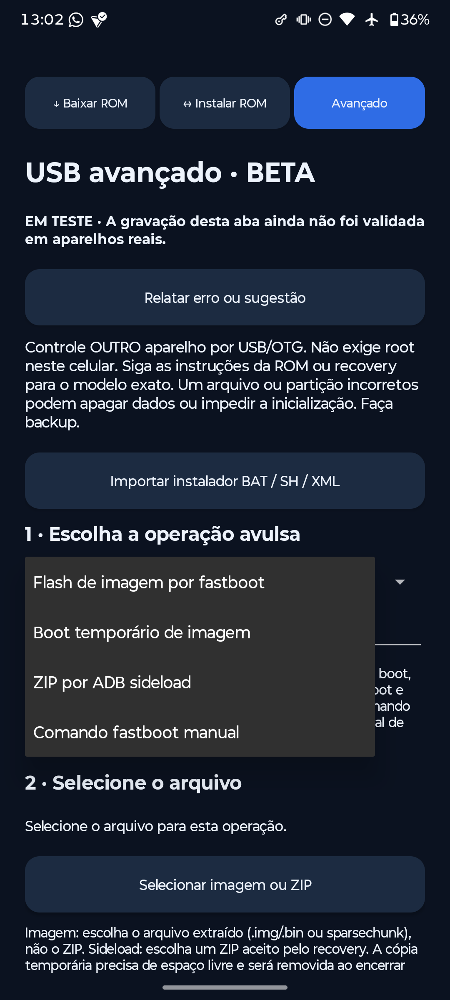

# ROMFlow — ROMs Motorola e ferramentas USB

**Aplicativo Android para consultar e baixar ROMs originais Motorola e realizar instalações e operações compatíveis em outro aparelho por USB/OTG, sem computador.**

Desenvolvido por **Técnico Root — Ivanildo Sousa**. Projeto independente, sem vínculo com Motorola ou Lenovo.

## Download

**[📥 Baixar a versão mais recente](https://github.com/paradaseimportsoficial-ops/ROMFlow/releases/latest)**

Na página da atualização, baixe **ROMFlow.apk**. Use a distribuição disponibilizada pelo autor. O arquivo **SHA256SUMS.txt** permite conferir o download.

## O que você pode fazer

- **Baixar ROM:** consultar o catálogo Motorola/Lenovo com conta, modelo XT e IMEI e baixar o pacote direto no celular.
- **Modelo automático:** o app tenta preencher o modelo do celular em que está instalado, sem root. Confira o resultado e informe o IMEI manualmente.
- **Reconhecer por fastboot:** identificar outro Motorola conectado por USB/OTG, quando o aparelho disponibilizar os dados.
- **Instalar ROM:** preparar e instalar firmware original compatível em outro Motorola por USB/OTG.
- **Avançado · BETA:** flash de imagens avulsas, seleção de slot A/B ou ambos, boot temporário de imagem, ZIP por ADB sideload e importação de instaladores BAT/SH/XML compatíveis.
- **Ajuda e suporte:** instruções no aplicativo e opção para relatar erros ou sugestões.

A aba Avançado pode ser utilizada com custom ROMs e recoveries **quando o pacote, o aparelho e as operações forem compatíveis**. Não há suporte universal a qualquer ROM, script ou celular.

## Requisitos e uso

- Android 10 ou superior, internet e espaço livre.
- Conta Motorola/Lenovo para consultar e baixar firmware original.
- Para operações USB: celular controlador com USB Host/OTG, cabo compatível e outro aparelho no modo indicado pelo guia da ROM.

A consulta manual e as funções USB **não exigem root**. A edição do GitHub oferece uma alternativa opcional em **Sobre → Consultar este celular com root**; a leitura do IMEI pode falhar mesmo com autorização.

Para começar, entre na conta, confira o modelo e informe o IMEI. A ajuda mostra onde encontrar esses dados nas configurações ou pelo código `*#06#` no app Telefone. Para outro aparelho, edite os dados ou use o reconhecimento USB.

**O ROMFlow controla outro aparelho durante a instalação USB. Não instala a ROM no celular que executa o app.**

## Antes de instalar

Faça backup e siga o guia específico do modelo, variante e ROM. Arquivos ou partições incorretos podem apagar dados ou impedir a inicialização. O aplicativo não desbloqueia nem bloqueia o bootloader, e tentar manter dados não garante sua preservação.

**Avançado permanece BETA:** suas novas operações de gravação ainda precisam de validação em aparelhos reais. A seleção de ambos os slots sobrescreve as duas cópias; não muda o slot ativo nem duplica uma ROM inteira automaticamente. Partições lógicas exigem o modo adequado e condições compatíveis do aparelho.

Instaladores importados têm suporte limitado. Revise todas as etapas e apagamentos apresentados. Quando o fluxo indicar formatação manual pelo recovery, conclua essa etapa antes de iniciar o Android. ZIP de recovery não deve ser usado como imagem de partição.

**Teste stock confirmado pelo autor:** instalação no Moto G84 com dados mantidos e inicialização concluída. Esse teste não valida outros modelos, outras ROMs ou as novas operações da aba Avançado.

## Atualizações

A edição do GitHub avisa quando há uma versão nova e pode exigir a atualização para continuar. Siga as instruções no app e confirme a instalação no Android.

## Capturas de tela

Capturas da versão 0.1.16; alguns detalhes podem diferir da versão atual.

| Baixar ROM | Instalar ROM |
| --- | --- |
|  |  |

| Avançado · BETA | Operações |
| --- | --- |
|  |  |

As imagens ilustram a interface e não comprovam testes físicos das operações.

## Privacidade, apoio e contato

O aplicativo contém anúncios e oferece apoio voluntário por Pix. Consulte a [política de privacidade](docs/PRIVACIDADE.md).

Suporte: [paradaseimportsoficial@gmail.com](mailto:paradaseimportsoficial@gmail.com). Ao relatar erros, informe a versão do app, o Android e o que aconteceu. Não publique IMEI, números de série, credenciais ou links de sessão.

## Créditos

Base técnica adaptada de [Moto Firmware Downloader, de JoshRob](https://github.com/JoshRob297/moto-firmware-downloader), sob [licença MIT](LICENSE-MFD.txt). As marcas pertencem aos respectivos titulares.

Este repositório público reúne a distribuição e a documentação de uso do ROMFlow.
