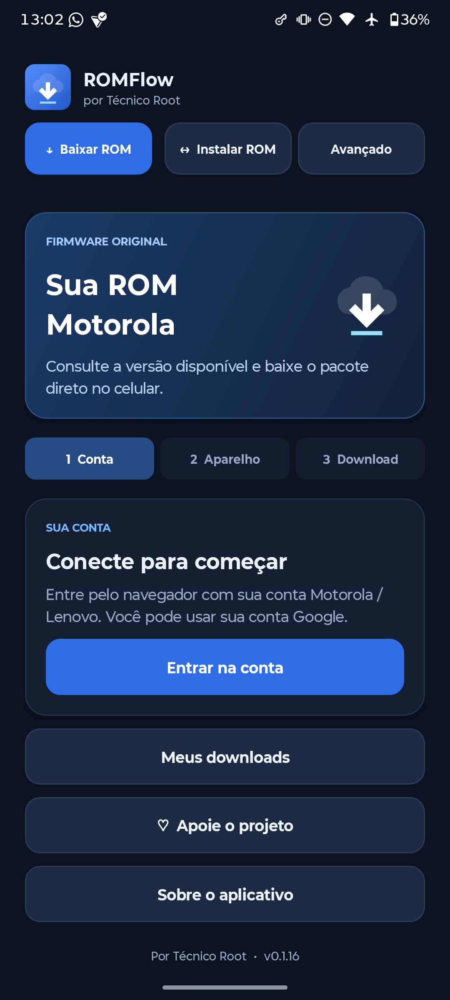

# ROMFlow — ROMs Motorola e ferramentas USB

**Aplicativo Android para consultar e baixar firmware original Motorola e realizar instalações e operações compatíveis em outro aparelho por USB/OTG, sem computador.**

Por **Técnico Root — Ivanildo Sousa**. Projeto independente, sem vínculo com Motorola ou Lenovo.

## Download

**[📥 Baixar a versão mais recente](https://github.com/paradaseimportsoficial-ops/ROMFlow/releases/latest)**

Baixe **ROMFlow.apk** na publicação mais recente. O arquivo **SHA256SUMS.txt** permite conferir o download. A atualização 0.1.20 traz uma **atualização de segurança**.

## Funções

- **Baixar ROM:** catálogo Motorola/Lenovo, consulta por modelo XT e IMEI e download no celular.
- **Modelo automático sem root:** confira a sugestão do modelo e informe o IMEI manualmente.
- **Reconhecimento USB:** identifica outro Motorola em fastboot por USB/OTG quando o aparelho fornece os dados.
- **Instalar ROM:** prepara e instala firmware original compatível em outro Motorola.
- **Avançado:** flash de imagens, seleção de slot A/B ou ambos, boot temporário, ZIP por ADB sideload e instaladores BAT/SH/XML compatíveis.

As operações avançadas também podem ser usadas com custom ROMs e recoveries compatíveis. Siga o guia específico do aparelho e do pacote; não há suporte universal a qualquer celular ou script.

## Como usar

É necessário Android 10 ou superior, internet e espaço livre. Para consultar o catálogo, entre na conta Motorola/Lenovo, confira o modelo e informe o IMEI. A ajuda do aplicativo mostra onde encontrar esses dados nas configurações ou com `*#06#` no app Telefone.

Para operações USB, use um celular controlador com USB Host/OTG, cabo compatível e outro aparelho no modo indicado pelo guia da ROM. **O ROMFlow não instala a ROM no próprio celular em que está aberto.**

A consulta manual e as funções USB não exigem root. A edição do GitHub oferece **Ler este celular com root** na tela de consulta, como alternativa opcional. O IMEI pode continuar indisponível mesmo com autorização; complete manualmente nesse caso.

## Antes de gravar

Faça backup e confirme modelo, variante e ROM. Arquivos ou partições incorretos podem apagar dados ou impedir a inicialização. Tentar manter dados não garante sua preservação. O aplicativo não desbloqueia nem bloqueia o bootloader.

Gravar ambos os slots sobrescreve as duas cópias; não muda o slot ativo nem duplica uma ROM inteira automaticamente. Use o modo adequado do aparelho para cada partição. Revise todas as etapas e apagamentos do instalador e conclua a formatação manual no recovery quando o fluxo exigir. ZIP de recovery não deve ser tratado como imagem de partição.

O autor relata testes em seus aparelhos, incluindo instalação stock no Moto G84. Isso não garante compatibilidade com todos os modelos, pacotes ou operações.

## Interface

Captura da versão 0.1.16; detalhes podem diferir da versão atual.

## Histórico das atualizações

| Versão | Resumo |
| --- | --- |
| 0.1.20 | Atualização de segurança. |
| 0.1.19 | Manutenção da interface. |
| 0.1.18 | Seleção de slots A/B no flash avulso e ajustes de navegação. |
| 0.1.17 | Sugestão automática do modelo sem root. |
| 0.1.16 | Operações USB avançadas e importação de instaladores compatíveis. |
| 0.1.15 | Identificação de outro Motorola por fastboot USB/OTG. |
| 0.1.14 | Preparação e instalação de ROM original por USB/OTG. |
| 0.1.13 | Atualização da apresentação do apoio por Pix. |
| 0.1.12 | Atualização da marca Técnico Root. |
| 0.1.11 | Publicidade e diagnóstico. |
| 0.1.10 | Padronização do nome ROMFlow e da pasta de downloads. |
| 0.1.9 | Consulta e download de firmware Motorola. |

As páginas das releases preservam as notas das versões. Prefira sempre o APK mais recente. Os links automáticos **Source code** do GitHub são cópias dos materiais deste repositório público: **não contêm o projeto Android do aplicativo**.

## Privacidade e suporte

O app contém anúncios e oferece apoio voluntário por Pix. Leia a [política de privacidade](docs/PRIVACIDADE.md).

Contato: [paradaseimportsoficial@gmail.com](mailto:paradaseimportsoficial@gmail.com). Ao relatar problemas, informe a versão do app, o Android e o que aconteceu. Não publique IMEI, credenciais ou links de sessão.

## Créditos

Base técnica adaptada de [Moto Firmware Downloader, de JoshRob](https://github.com/JoshRob297/moto-firmware-downloader), sob [licença MIT](THIRD_PARTY_LICENSES.txt). Marcas pertencem aos respectivos titulares.

Este repositório público reúne a distribuição e a documentação de uso.

## Licença e autenticidade

As contribuições originais do ROMFlow seguem os termos da [licença do aplicativo](LICENSE). Os componentes de terceiros mantêm suas próprias permissões e créditos em [THIRD_PARTY_LICENSES.txt](THIRD_PARTY_LICENSES.txt). A licença MIT da base de JoshRob não se aplica automaticamente a todas as contribuições originais do ROMFlow.

Consulte [Segurança e autenticidade](SECURITY.md) para conferir o certificado oficial e relatar vulnerabilidades em particular.
