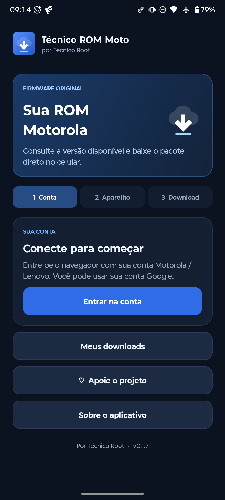
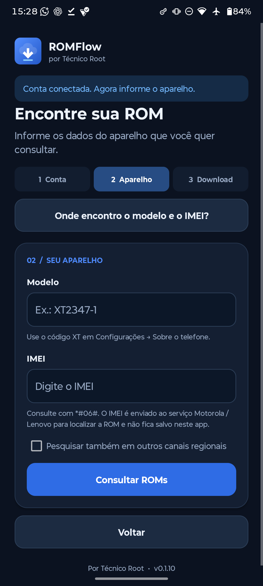
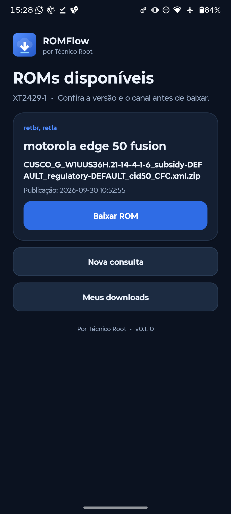
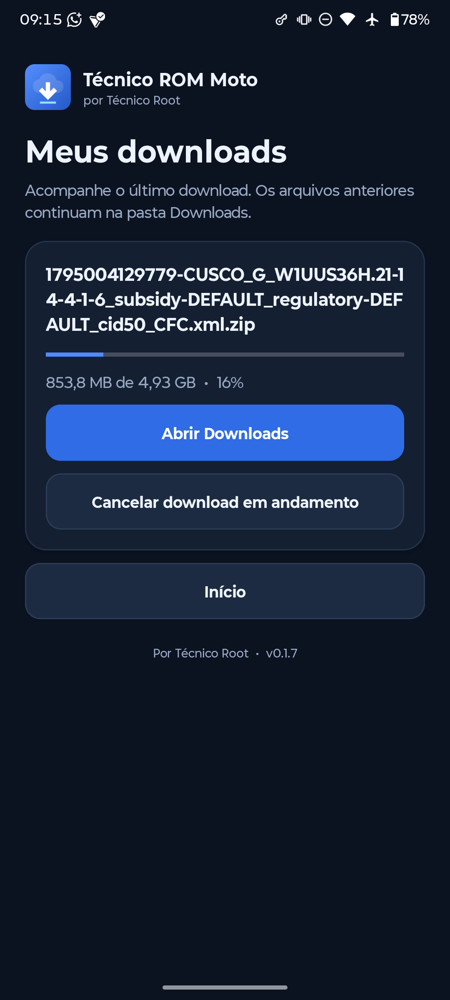
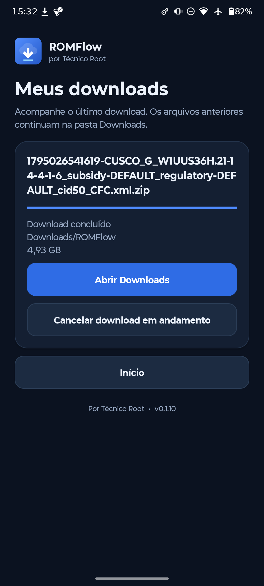

# ROMFlow

**Download de firmwares no Android — por Técnico Root.**

Consulte pacotes de firmware e acompanhe o download em uma interface simples, sem precisar instalar Termux ou executar comandos.

> **ROMFlow 0.1.10 — por Técnico Root.** Aplicativo independente para consultar e baixar pacotes de firmware pelo Android. Não instala nem grava a ROM no aparelho.

## O que o aplicativo faz

- Abre o login Motorola/Lenovo no navegador externo, inclusive para quem usa conta Google.
- Consulta o catálogo usando o código do modelo e o IMEI informados pelo usuário.
- Apresenta os pacotes retornados e permite escolher qual baixar.
- Mostra o andamento e salva o ZIP em **Downloads/ROMFlow**.
- Inclui ajuda ilustrada para localizar modelo e IMEI.
- Continua o download pelo gerenciador do Android quando você sai da tela.

O app baixa o pacote; a instalação ou gravação da ROM é uma etapa separada. O serviço pode não disponibilizar todos os modelos, versões ou canais. A conclusão da transferência não certifica a compatibilidade da ROM para gravação nem sua integridade criptográfica.

## Download

**[Baixar a versão mais recente](https://github.com/paradaseimportsoficial-ops/ROMFlow/releases/latest)**

Na seção Releases, baixe **ROMFlow.apk**. O arquivo **SHA256SUMS.txt** permite conferir a integridade do download.

O GitHub é o canal de distribuição direta. A edição da VIVO está prevista e depende de cadastro, envio e aprovação; ainda não está publicada na loja.

## Como usar

1. Abra o aplicativo e escolha conectar a conta.
2. Conclua o login na página Motorola/Lenovo pelo navegador. Se a página apresentar o botão de abrir o cliente Software Fix, toque nele para retornar ao aplicativo.
3. Confira se a conta foi reconhecida.
4. Digite o código completo do modelo (por exemplo, o código XT que aparece nas informações do aparelho) e o IMEI. O botão de ajuda mostra onde encontrá-los.
5. Consulte os pacotes, confira as informações e escolha o download.
6. Acompanhe em Meus downloads. O ZIP ficará disponível em Downloads/ROMFlow.

Use somente identificadores de aparelhos próprios ou que você tenha autorização para consultar. Se o login não concluir, não publique URLs de retorno: elas podem conter um código de sessão.

## Requisitos

- Android 10 ou superior.
- Conta compatível com o serviço Motorola/Lenovo.
- Internet e espaço para pacotes que podem ocupar vários gigabytes.

Não exige root e não lê o IMEI automaticamente. A interface é em português.

## Anúncios e apoio

O projeto pretende se sustentar com publicidade AdMob e contribuições voluntárias por Pix. As edições assinadas de distribuição usam o bloco real do criador. A disponibilidade de anúncios e a geração de receita dependem da plataforma e de sua revisão; a preparação de um APK não é uma aprovação.

O anúncio intersticial tem uma única oportunidade na conclusão de um download acompanhado em primeiro plano. Um download que já terminou antes de voltar à tela não abre um anúncio atrasado. Quando não há anúncio disponível, o arquivo continua acessível.

O Pix é opcional. O aplicativo não acessa a conta bancária do usuário nem executa ou confirma pagamentos.

## Atualizações

A edição do GitHub consulta novas versões em Releases ao abrir ou retornar ao aplicativo. Quando encontra uma versão mais recente, a atualização é obrigatória para continuar: é possível atualizar ou sair. A exigência já detectada permanece salva mesmo sem conexão. Se a consulta falhar antes de detectar uma atualização, o app permite usar a versão instalada. Ao iniciar a atualização, o APK é baixado e verificado por SHA-256, pacote, versão e assinatura. O Android pede confirmação para instalar. O canal consulta a Release pública mais recente deste repositório. Quem usa a versão 0.1.9 ou anterior precisa instalar a 0.1.10 pelo link uma vez para migrar ao novo endereço de atualização. Não é necessário desinstalar as edições com a assinatura definitiva.

A edição de loja recebe atualizações pela loja e não inclui a permissão para instalar APKs. As duas edições mantêm o mesmo nome de pacote e certificado definitivo. A troca entre canais também depende da versão e das políticas de assinatura da loja.

As versões antigas de teste têm outro certificado. A primeira migração para a assinatura definitiva exige remover a edição de teste e entrar novamente na conta. As edições definitivas 0.1.7 e posteriores usam a mesma assinatura e podem receber versões compatíveis por cima, sem desinstalar.

## Privacidade

A sessão técnica é armazenada de forma criptografada no aparelho. O modelo e o IMEI digitados são enviados ao serviço Motorola/Lenovo para a consulta; não são gravados deliberadamente pelo app em histórico ou relatórios do criador. O SDK de anúncios trata seus próprios dados de publicidade/diagnóstico.

Leia a [política de privacidade](docs/PRIVACIDADE.md), também disponível offline no aplicativo. E-mail de suporte: [paradaseimportsoficial@gmail.com](mailto:paradaseimportsoficial@gmail.com).

## Capturas de tela

Capturas reais da versão 0.1.10, enviadas pelo autor após consulta e download concluído no celular.

| Início | Consulta | Resultados |
| --- | --- | --- |
|  |  |  |

| Download em andamento | Download concluído |
| --- | --- |
|  |  |

## Autoria e créditos

Desenvolvido por **Técnico Root — Ivanildo Sousa Castro**. Projeto independente, não oficial, sem vínculo declarado com Motorola ou Lenovo. As marcas pertencem aos respectivos titulares.

A base técnica foi adaptada de [Moto Firmware Downloader, de JoshRob](https://github.com/JoshRob297/moto-firmware-downloader), revisão b5ea93a (v1.3.4), sob [licença MIT](LICENSE-MFD.txt). Essa licença cobre o código do projeto de origem e não equivale a autorização para o serviço ou os arquivos Motorola/Lenovo.

## Suporte

Contato: [paradaseimportsoficial@gmail.com](mailto:paradaseimportsoficial@gmail.com). Ao relatar um problema, informe a versão do app, versão do Android e o texto do erro. Remova IMEI, tokens, links de sessão e dados pessoais das imagens.

A documentação será atualizada conforme o estado real de publicação e aprovação.

## Autenticidade da distribuição

Os APKs da distribuição do autor usam a assinatura definitiva do autor, código ofuscado com R8 e verificação local de assinatura. Essas medidas dificultam alterações, mas não impedem toda engenharia reversa. Este repositório público distribui APKs e documentação; a chave privada, o código-fonte do aplicativo e os mapas de ofuscação não são publicados.
