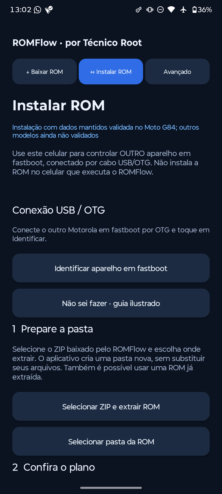
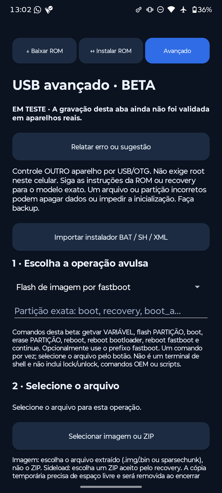
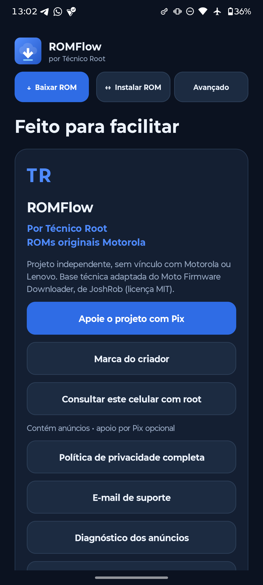
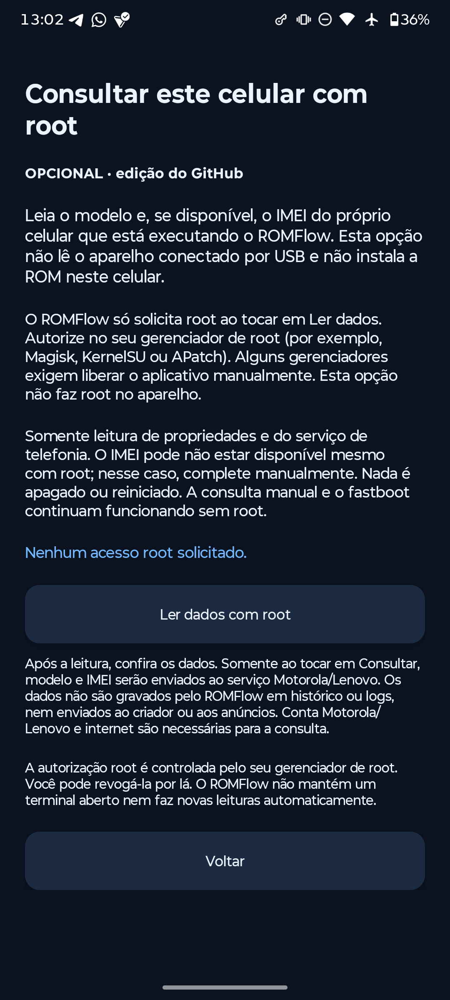

# ROMFlow

**Baixe, prepare e instale ROMs stock pelo Android — por Técnico Root.**

Três abas: **Baixar ROM**, **Instalar ROM** e **Avançado**. Consulte o firmware, extraia o ZIP, confira os arquivos e instale em outro Motorola por USB/OTG, sem Termux ou computador.

> **ROMFlow 0.1.17 — por Técnico Root.** Aplicativo independente. A instalação exige outro aparelho em fastboot, cabo de dados e OTG compatíveis; não grava a ROM no celular que executa o ROMFlow.

## Novidades da versão 0.1.17

### Modelo automático sem root

Ao abrir a consulta de ROM, o aplicativo tenta preencher o **código XT do próprio celular**, sem pedir root. Confira o modelo e informe o **IMEI manualmente**. O código depende do que o Android disponibilizar; se não houver um XT válido, complete o campo. Para consultar outro aparelho, edite o modelo ou use o reconhecimento por fastboot USB/OTG.

O preenchimento automático foi testado e confirmado pelo autor. A opção de tentar ler modelo e IMEI com root continua em **Sobre**, na edição do GitHub; o IMEI com root ainda pode não estar disponível.

A aba **Avançado permanece BETA**: suas funções de gravação novas ainda não foram validadas fisicamente. A consulta/download e o fluxo stock mantêm os testes já descritos abaixo. O acesso root é opcional e a leitura do IMEI depende da ROM.

### Root é uma alternativa, não uma obrigação

Na edição do GitHub 0.1.17, entre em **Sobre → Consultar este celular com root** se quiser tentar identificar o **próprio celular que executa o ROMFlow** para consultar e baixar sua ROM.

1. Toque em **Ler dados com root** somente se quiser usar essa alternativa.
2. Autorize o ROMFlow no seu gerenciador de root; em alguns gerenciadores é necessário liberar o app manualmente.
3. Confira o modelo e o IMEI mascarado. Toque em **Consultar ROM deste celular**, ou complete manualmente se faltarem dados.
4. Consulte o catálogo e baixe a ROM normalmente, usando a conta Motorola/Lenovo e internet.

**O ROMFlow não pede root ao abrir.** A consulta manual e a leitura de outro aparelho por fastboot continuam disponíveis **sem root**. Autorizar root não instala nem atualiza o Android do celular que executa o aplicativo. A leitura tenta obter os dados automaticamente e informa quando o sistema recusa ou não retorna o IMEI. Ela pode não obter o IMEI mesmo com root; nenhum identificador é registrado em logs ou histórico pelo código do app. A autorização pode ser revogada no gerenciador de root.

A edição destinada à **V-Appstore da Vivo não inclui essa função no APK**. Isso não representa garantia de aprovação: a loja analisa o aplicativo completo.

### USB avançado e importação de instaladores (beta)

Em **Avançado · BETA**, selecione uma imagem para `fastboot flash` ou boot temporário, use um comando fastboot suportado ou envie um ZIP pelo **ADB sideload do recovery**. Essas operações controlam outro aparelho por USB/OTG e não exigem root no celular com ROMFlow. Um ZIP de recovery não deve ser gravado como imagem.

Para automatizar uma sequência, abra **Importar instalador BAT / SH / XML**, selecione a pasta extraída da ROM e escolha o instalador. O app lê as referências, confere e copia todos os arquivos necessários, mostra o plano e pede confirmação antes de gravar. É necessário espaço livre para a cópia temporária das imagens.

- **BAT/SH literal:** comandos fastboot suportados, com nomes relativos dos arquivos. Variáveis, laços, condicionais e comandos externos exigem adaptação; o app recusa o instalador inteiro antes de gravar. Mudanças de modo no meio de uma sequência genérica não estão disponíveis nesta beta.
- **XML Motorola:** verifica os checksums e mantém as operações declaradas, inclusive apagamentos apresentados na revisão. O fluxo guiado de stock continua em **Instalar ROM**.
- **Instalador interativo reconhecido:** adapta o fluxo do BAT de exemplo com seis imagens, bootloader → fastbootd, slot ativo, remoção de partições lógicas do slot inativo e preparação das partições do slot ativo. Não é suporte irrestrito a qualquer BAT ou custom ROM. O programa precisa corresponder ao perfil aceito; outras versões podem exigir adaptação.

**No fluxo interativo reconhecido:** confirme a base stock exata e as instruções do pacote. O perfil reaproveita o kernel existente e remove o sistema do slot inativo. O app exige bootloader já desbloqueado e serial disponível para reconfirmar o mesmo destino após a mudança de modo; pode ser necessário autorizar USB novamente. Ele não desbloqueia o aparelho. A opção manter dados só deve ser usada quando o guia permitir, estando na mesma ROM.

**Instalação limpa do fluxo interativo nesta beta exige formatação manual pelo recovery após a gravação, antes de iniciar o Android.** O app não implementa `fastboot -w`, não apaga userdata/metadata nessa escolha e não reinicia automaticamente para o Android enquanto a formatação está pendente. O término da gravação não confirma que essa etapa foi feita.

O botão **Relatar erro ou sugestão** abre um rascunho no aplicativo de e-mail para você revisar e enviar ao suporte. Inclui apenas versão do app/Android, área e campos para descrever o caso; não envia nada automaticamente nem inclui IMEI, número de série ou sessão. O contato também fica em Sobre.

**Limites de teste:** funções avançadas e leitura de IMEI com root ainda precisam de validação em aparelhos reais. Imagens maiores que o limite de transferência do destino são recusadas; não há fracionamento automático. Sideload aceita recovery compatível e não oferece ADB autenticado do Android normal. Não há paridade completa com Bugjaeger nem execução livre de Windows/Bash.

## O que o aplicativo faz

- Abre o login Motorola/Lenovo no navegador externo, inclusive para quem usa conta Google.
- Sugere automaticamente o modelo XT do próprio celular, sem root, quando o Android o disponibiliza.
- Consulta o catálogo com o modelo conferido e IMEI informado, ou com os dados lidos de outro Motorola em fastboot por USB/OTG.
- Apresenta os pacotes retornados e permite escolher qual baixar.
- Mostra o andamento e salva o ZIP em **Downloads/ROMFlow**.
- Inclui ajuda ilustrada para localizar modelo e IMEI.
- Continua o download pelo gerenciador do Android quando você sai da tela.

- Extrai o ZIP dentro do aplicativo em uma pasta nova.
- Lê o flashfile.xml, verifica os checksums dos arquivos e permite salvar **flash-romflow.sh**.
- Reconhece outro Motorola em fastboot e instala diretamente por USB/OTG.
- Permite escolher instalação limpa ou tentar manter dados e reiniciar automaticamente após sucesso.
- Mostra um guia ilustrado e o progresso da gravação.

O serviço pode não disponibilizar todos os modelos, versões ou canais. Produto e checksums não comprovam compatibilidade de variante ou downgrade. O aplicativo não desbloqueia nem bloqueia o bootloader.

**Teste confirmado pelo autor:** Moto G84 (bangkk), 23 arquivos, 27 etapas no modo tentar manter dados; Android iniciou, arquivos, senha e Wi-Fi foram preservados e o root foi removido. O reinício automático também foi testado. Outros modelos, outras ROMs e instalação limpa não foram validados por esse teste. Não há garantia geral de preservação dos dados; faça backup.

## Download

**[Baixar a versão mais recente](https://github.com/paradaseimportsoficial-ops/ROMFlow/releases/latest)**

Na seção Releases, baixe **ROMFlow.apk**. O arquivo **SHA256SUMS.txt** permite conferir a integridade do download.

O GitHub é o canal de distribuição direta. A edição da VIVO está prevista e depende de cadastro, envio e aprovação; ainda não está publicada na loja.

## Como usar

1. Abra o aplicativo e escolha conectar a conta.
2. Conclua o login na página Motorola/Lenovo pelo navegador. Se a página apresentar o botão de abrir o cliente Software Fix, toque nele para retornar ao aplicativo.
3. Confira se a conta foi reconhecida.
4. Confira o modelo preenchido automaticamente, se disponível, e informe o IMEI. Para outro aparelho, edite o modelo ou use fastboot. Use a ajuda ilustrada para encontrar o código XT nas configurações e o IMEI pelas configurações ou digitando `*#06#` no teclado do app Telefone. Digite o código completo do modelo (por exemplo, o código XT que aparece nas informações do aparelho) e o IMEI. O botão de ajuda mostra onde encontrá-los.
5. Consulte os pacotes, confira as informações e escolha o download.
6. Acompanhe em Meus downloads. O ZIP ficará disponível em Downloads/ROMFlow.

### Buscar ROM pelo fastboot, sem digitar modelo e IMEI

1. Entre na conta Motorola/Lenovo e abra **Buscar ROM**.
2. Toque em **Reconhecer por fastboot · USB/OTG**.
3. Coloque o outro Motorola em fastboot e conecte-o por cabo de dados/OTG ao celular com ROMFlow.
4. Toque em **Reconhecer aparelho** e autorize o acesso USB no Android.
5. Confira o modelo e o final do IMEI na tela; toque em **Consultar ROMs deste aparelho** para buscar os pacotes.

A leitura não grava, apaga ou reinicia. Se o bootloader não fornecer todos os dados válidos, complete os campos manualmente. A conta e a conexão à internet continuam necessárias para consultar o catálogo. Modelo e IMEI só são enviados ao serviço Motorola/Lenovo ao consultar; o código do app não os envia ao criador nem aos anúncios e não os salva em histórico.

**Teste confirmado na beta 0.1.15:** Moto G84 (XT2347-1) reconhecido por USB em fastboot, modelo e IMEI lidos, catálogo retornou a ROM BANGKK_G nos canais retbr/retla, sem digitar os identificadores. A consulta manual permanece disponível.

Use somente identificadores de aparelhos próprios ou que você tenha autorização para consultar. Se o login não concluir, não publique URLs de retorno: elas podem conter um código de sessão.

## Instalar em outro Motorola

1. Faça backup e confirme modelo, variante e versão compatíveis da ROM. Não use este fluxo para custom ROM.
2. Abra **Instalar ROM**, selecione o ZIP e extraia, ou selecione a pasta já extraída.
3. Desligue o aparelho de destino e entre em fastboot com Volume para baixo + Ligar. Conecte-o por cabo USB/OTG ao celular que executa o ROMFlow.
4. Toque em **Identificar aparelho em fastboot** e autorize o acesso USB no Android.
5. Confira o XML e os arquivos, revise as etapas e, opcionalmente, salve o script. Salvar o script não é necessário para instalar pelo app.
6. Escolha instalação limpa ou tentar manter dados. Marque o reinício automático se desejar e confirme por escrito **INSTALAR**.
7. Acompanhe a conclusão sem desconectar o cabo. Se houver erro, a sequência para sem repetição automática. Confira a inicialização do Android após a conclusão.

A instalação limpa apaga dados previstos no XML. Tentar manter dados omite operações de userdata, metadata e carrier, mas não garante preservação. Apagamentos de modemst1/modemst2 exigem autorização separada. Imagens acima do limite de transferência do aparelho são recusadas antes da gravação; não há fracionamento automático.

## Requisitos

- Android 10 ou superior.
- Conta compatível com o serviço Motorola/Lenovo.
- Internet e espaço para o ZIP e os arquivos extraídos, que podem ocupar vários gigabytes.
- Para instalar: USB Host/OTG no celular controlador, outro Motorola em fastboot e bootloader que permita gravar o firmware escolhido.

Não exige root. O modelo e IMEI podem ser digitados ou lidos de outro Motorola em fastboot, mediante autorização USB. A interface é em português.

## Anúncios e apoio

O projeto pretende se sustentar com publicidade AdMob e contribuições voluntárias por Pix. As edições assinadas de distribuição usam o bloco real do criador. A disponibilidade de anúncios e a geração de receita dependem da plataforma e de sua revisão; a preparação de um APK não é uma aprovação.

A partir da versão 0.1.11, o aplicativo pode exibir um anúncio após a confirmação do download e antes de iniciar a transferência. Ao fechar o anúncio, o download começa automaticamente; se nenhum estiver pronto ou houver falha, ele começa normalmente. Também há uma oportunidade na conclusão acompanhada em primeiro plano, com intervalo mínimo de um minuto entre exibições para evitar anúncios seguidos em downloads rápidos. Um download que terminou fora da tela não abre anúncio atrasado. Em Sobre, Diagnóstico dos anúncios mostra o estado do carregamento e erros técnicos locais, sem IMEI, modelo ou sessão. Publicar no GitHub não garante aprovação nem veiculação no AdMob.

Na instalação, há uma oportunidade de anúncio ao avançar da conferência para a revisão. Nenhum anúncio é exibido durante a gravação USB. O anúncio indisponível não bloqueia o fluxo.

O Pix é opcional. O aplicativo não acessa a conta bancária do usuário nem executa ou confirma pagamentos. Na versão 0.1.13, o QR Code e o Copia e Cola incluem a descrição **Apoio ao ROMFlow** e o identificador **ROMFLOWAPOIO20261118**. No teste do autor, o identificador apareceu no comprovante da conta Nubank recebedora; a apresentação pode variar em outros bancos.

## Atualizações

A edição do GitHub consulta novas versões em Releases ao abrir ou retornar ao aplicativo. Quando encontra uma versão mais recente, a atualização é obrigatória para continuar: é possível atualizar ou sair. A exigência já detectada permanece salva mesmo sem conexão. Se a consulta falhar antes de detectar uma atualização, o app permite usar a versão instalada. Ao iniciar a atualização, o APK é baixado e verificado por SHA-256, pacote, versão e assinatura. O Android pede confirmação para instalar. O canal consulta a Release pública mais recente deste repositório. Quem usa a versão 0.1.9 ou anterior precisa instalar a versão atual pelo link de download deste repositório para migrar ao novo endereço de atualização. Não é necessário desinstalar as edições com a assinatura definitiva.

A partir da versão 0.1.15, a tela de atualização destaca as novidades da versão disponível. Ao abrir uma versão recém-instalada, um resumo das novidades aparece uma vez e também funciona sem internet. A tela Sobre não precisa de botões manuais de atualização: a verificação continua automática, e a tela obrigatória permite retomar a instalação já baixada.

A edição de loja recebe atualizações pela loja e não inclui a permissão para instalar APKs. As duas edições mantêm o mesmo nome de pacote e certificado definitivo. A troca entre canais também depende da versão e das políticas de assinatura da loja.

As versões antigas de teste têm outro certificado. A primeira migração para a assinatura definitiva exige remover a edição de teste e entrar novamente na conta. As edições definitivas 0.1.7 e posteriores usam a mesma assinatura e podem receber versões compatíveis por cima, sem desinstalar.

## Privacidade

A sessão técnica é armazenada de forma criptografada no aparelho. O modelo e o IMEI digitados ou lidos por USB são enviados ao serviço Motorola/Lenovo para a consulta; não são gravados deliberadamente pelo app em histórico ou relatórios do criador. O SDK de anúncios trata seus próprios dados de publicidade/diagnóstico.

Leia a [política de privacidade](docs/PRIVACIDADE.md), também disponível offline no aplicativo. E-mail de suporte: [paradaseimportsoficial@gmail.com](mailto:paradaseimportsoficial@gmail.com).

## Capturas de tela

Capturas reais da versão **0.1.16**, enviadas pelo autor, que ilustram a interface mantida na 0.1.17. A navegação reúne **Baixar ROM**, **Instalar ROM** e **Avançado**; a área avançada permanece **BETA**.

| Baixar ROM | Instalar ROM |
| --- | --- |
|  |  |

| Avançado · BETA | Operações disponíveis |
| --- | --- |
|  |  |

| Sobre o aplicativo | Consulta com root opcional |
| --- | --- |
|  |  |

As imagens mostram a interface. **Não comprovam validação física das novas operações da aba Avançado nem leitura bem-sucedida de IMEI com root.** O teste stock confirmado no Moto G84 está descrito acima.

## Autoria e créditos

Desenvolvido por **Técnico Root — Ivanildo Sousa**. Projeto independente, não oficial, sem vínculo declarado com Motorola ou Lenovo. As marcas pertencem aos respectivos titulares.

A base técnica foi adaptada de [Moto Firmware Downloader, de JoshRob](https://github.com/JoshRob297/moto-firmware-downloader), revisão b5ea93a (v1.3.4), sob [licença MIT](LICENSE-MFD.txt). Essa licença cobre o código do projeto de origem e não equivale a autorização para o serviço ou os arquivos Motorola/Lenovo.

## Suporte

Contato: [paradaseimportsoficial@gmail.com](mailto:paradaseimportsoficial@gmail.com). Ao relatar um problema, informe a versão do app, versão do Android e o texto do erro. Remova IMEI, tokens, links de sessão e dados pessoais das imagens.

A documentação será atualizada conforme o estado real de publicação e aprovação.

## Distribuição

Use os APKs disponibilizados pelo autor na seção Releases. Este repositório público disponibiliza os aplicativos e a documentação de uso.

